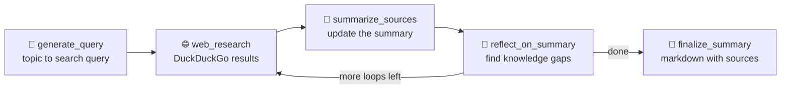

<div align="center">

# Qwen Deep Researcher

**A fully local web research assistant. Give it a topic, get a cited markdown report.**

It writes a search query, reads the results, summarizes them, finds the gaps<br>
and searches again. Everything runs on your machine through Ollama.

<br>


[**Features**](#features) · [**How it works**](#how-it-works) · [**Getting started**](#getting-started) · [**Configuration**](#configuration) · [**Project structure**](#project-structure)

</div>

<br>

> [!NOTE]
> This project is based on [Local Deep Researcher](https://github.com/langchain-ai/local-deep-researcher) by Lance Martin, set up to run with the Qwen3 family of models.

<a id="features"></a>

## ✨ Features

| Feature | What you get |
|:---|:---|
| 🔒 **Fully local** | Any LLM served by [Ollama](https://ollama.com/search). The default model is `qwen3:8b-q4_K_M`. |
| 🔁 **Iterative research** | Search, summarize, reflect, then search again to close the gaps. Runs for a set number of loops. |
| 🦆 **No search key needed** | DuckDuckGo is the default search tool and needs no API key. |
| 📑 **Cited output** | The final markdown report lists every source used. |
| 🧠 **Thinking cleanup** | `<think>` tokens from reasoning models are stripped from the output by default. |
| 🧰 **LangGraph Studio** | Watch the graph run, inspect state and tweak settings in the browser. |

<a id="how-it-works"></a>

## ⚙️ How it works



The approach is inspired by [IterDRAG](https://arxiv.org/html/2410.04343v1): break a question into sub-queries, answer each one, and build on the earlier answers.

1. **Query:** the local LLM turns your topic into a web search query.
2. **Research:** the search tool finds sources. With `FETCH_FULL_PAGE` on, full pages are fetched and converted to markdown.
3. **Summarize and reflect:** the LLM updates the running summary, then names what is still missing and writes a new query for it.
4. **Finish:** after the configured number of loops, the graph outputs one markdown summary. All gathered sources stay in the graph state.

<a id="getting-started"></a>

## 🚀 Getting started

**Requirements:** Python 3.11+, [Ollama](https://ollama.com/download) and Git.

**1. Get a local model**

```bash
ollama pull qwen3:latest
```

**2. Clone and install**

```bash
git clone https://github.com/DevloperHS/qwen_deep_researcher.git
cd qwen_deep_researcher
python -m venv .venv
source .venv/bin/activate        # Windows: .venv\Scripts\Activate.ps1
pip install -e .
pip install -U "langgraph-cli[inmem]"
```

**3. Add your settings**

```bash
cp env.example .env
```

Edit `.env` to pick your model and search settings. `langgraph.json` points at this file, so the values load automatically.

**4. Start the server**

```bash
ollama serve                     # if Ollama is not already running
langgraph dev
```

You should see:

```text
API: http://127.0.0.1:2024
Docs: http://127.0.0.1:2024/docs
LangGraph Studio Web UI: https://smith.langchain.com/studio/?baseUrl=http://127.0.0.1:2024
```

Open the Studio URL, enter a research topic and watch the graph work.

> [!TIP]
> Studio works best in **Firefox**. Safari may show mixed-content warnings (HTTPS page, HTTP server). If something looks broken, try another browser or turn off ad blockers.

<a id="configuration"></a>

## 🎛️ Configuration

Set these in `.env` or in the **configuration** tab in Studio.

| Variable | Default | What it does |
|:---|:---|:---|
| `LOCAL_LLM` | `qwen3:8b-q4_K_M` | Ollama model name. |
| `LLM_PROVIDER` | `ollama` | LLM provider. Only Ollama is supported here. |
| `OLLAMA_BASE_URL` | `http://localhost:11434/` | Where Ollama is running. |
| `MAX_WEB_RESEARCH_LOOPS` | `3` | How many search and reflect cycles to run. |
| `SEARCH_API` | `duckduckgo` | Search tool. Only DuckDuckGo is supported here. |
| `FETCH_FULL_PAGE` | `true` | Fetch full page content instead of snippets. |
| `STRIP_THINKING_TOKENS` | `true` | Remove `<think>` blocks from model output. |

Priority order: environment variables, then the Studio configuration tab, then the defaults in `configuration.py`.

<details>
<summary><b>Model compatibility</b></summary>

<br>

The query and reflection steps ask for structured JSON. Some small models struggle with that, for example DeepSeek R1 at 1.5B and 7B. The assistant has a fallback for bad JSON, but results from those models will be weaker. Qwen3 models handle it well.

</details>

<a id="project-structure"></a>

## 🗂️ Project structure

```text
qwen_deep_researcher/
├── langgraph.json                    # Graph entry point and env file
├── pyproject.toml
├── env.example                       # Copy to .env
└── src/ollama_deep_researcher/
    ├── graph.py                      # The five nodes and their routing
    ├── configuration.py              # Settings and their defaults
    ├── prompts.py                    # Query, summary and reflection prompts
    ├── state.py                      # Graph state
    └── utils.py                      # Search, source formatting, thinking-token cleanup
```

## 📤 Output

The result is a markdown summary with citations. The final summary and every source gathered are saved in the graph state, so you can inspect them in Studio.

## 📄 License

This repository includes the [GNU GPL v3](LICENSE) license file.

<div align="center">
<br>
<sub>Ask. Search. Reflect. Repeat.</sub>
</div>
